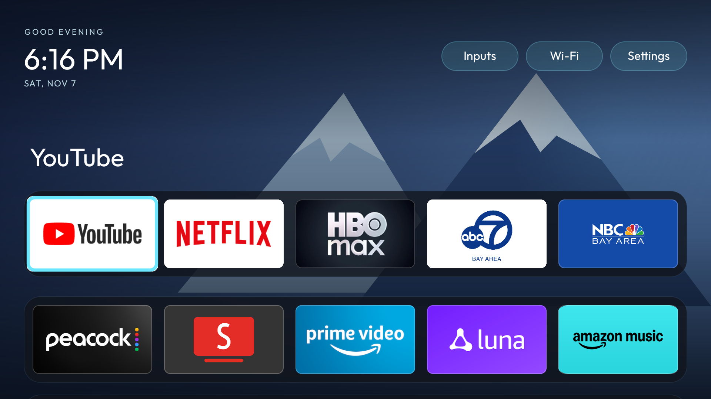

# Homestead Outfit

Custom launcher based on Homestead **1.9.0**, with the Outfit font, Aurora-inspired app docks, five ordered favorites, top-right Inputs / Wi-Fi / Settings controls, focus labels, and daily nature/abstract wallpapers. Android package: `com.cleantv.outfit`; original Homestead remains a separate fallback.



## Keeping upstream merges small

`outfit` includes upstream `main` through `cbc1bb8` (1.9.0). Merge upstream normally; do not replace upstream files with old Outfit copies or blindly resolve conflicts using ours/theirs.

Custom behavior lives in added files:

- `OutfitLayout.java`: header, favorites, app docks, focus labels and input picker. Uses upstream app models, tile creation and actions.
- `OutfitBackgrounds.java`, `ScenicWallpaper.java`, `OutfitWallpaperSchedule.java`: wallpaper controls, original vector artwork, local-date rotation and legacy setting migration.
- `OutfitDefaults.java`: one-time preferences and hidden-app defaults, without changing upstream `Prefs`.
- `OutfitTextView.java`: typography used by Outfit views and the shared panel text factory.

Only five upstream Java files have integration changes: `HomeGrid` (presentation hooks and Menu action), `Backgrounds` (custom preset lookup), `SettingsPanel` (wallpaper panel entry), `Panel` (text factory), and `DebloatPanel` (all-installed-app shortcut and connection entry). `.gitignore` adds staging/credential exclusions. Everything else supplied by upstream—including README, manifest, build scripts, Home service, package-management logic and preferences—matches upstream exactly.

`outfit/prepare-build.py` stages a disposable `.outfit-build/` tree. It changes only build identity and branding: package declarations/provider authorities, app label/version suffix, update repository, and theme resources. It does **not** apply behavioral patches. This keeps namespace churn out of every upstream source file, while producing the same installed package and using the same local signing key. `build.sh` alone builds the upstream identity; use `build-local.sh` for Outfit.

## Build and verify

Set `HOMESTEAD_KEYPASS` to your local signing password and run `bash build-local.sh`. Local Java/Android tools and the existing Outfit signing key are expected in `../output/`. Never publish the signing key. The output is `homestead.apk`, with signature verification performed by the upstream build.

Set `JAVA_HOME` to a JDK and run `bash outfit/test.sh`. Tests cover daily selection across daylight-saving/leap-year boundaries, every legacy wallpaper ID (including photo ID 5), and the allowed upstream customization boundary. After staging, inspect the APK package, provider authorities and version before installation.

For the next upstream update:

```sh
git fetch upstream
git merge upstream/main
bash outfit/test.sh
bash build-local.sh
```

Resolve integration changes against the new upstream API. The boundary check catches accidental edits outside the five approved files; it does not guarantee all future merges are conflict-free. Test remote navigation, Home handoff, wallpaper selection and debloat browsing on the TV before deploying a major upstream update.

## Daily backgrounds

Settings → Background offers Change daily and Daily collection (Nature + abstract, Nature, Abstract). Sixteen offline vector wallpapers span mountains, forests, deserts, oceans, sunset canyons, moonlit pines, glaciers, tropical islands, flowing abstracts, an eclipse, prismatic glass, constellations and coral waves. Mixed rotation visits all sixteen before repeating; nature and abstract collections each contain eight. Existing artwork IDs remain stable. Dark gradients protect the clock, controls and dock. Mixed rotation alternates nature and abstract. Turn daily rotation off to keep today's artwork. Other colors and custom photo opens upstream's full background chooser.

Rotation follows the TV's local date and refreshes on its minute tick or return Home. Existing numeric Outfit choices migrate once to namespaced IDs; custom photos, daily modes and fixed artworks retain their selections. No downloads, added permissions or wakeup timers are required.

## Install / restore

Set `TV` to the TV's address including `:5555`, then run `bash build-and-install.sh` with the signing password set. `restore-original-homestead.sh` returns Home to the original app. Both scripts preserve unrelated accessibility services. READ_LOGS supports the existing Home redirect; no firmware or root changes are made.

Favorites remain YouTube, Netflix, HBO Max, ABC7, NBC Bay Area. Total Commander, Downloader and AirPlay are hidden once by default and can be restored through Settings. The font is a static Outfit regular instance for Android 9 compatibility.

## Attribution

Homestead code is GPL-3.0. Outfit is SIL OFL (`OUTFIT-LICENSE.txt`). Aurora wallpaper comes from [CleanYourTV Aurora](https://github.com/Gathin23/cleanyourtv/tree/main/themes/aurora) under MIT (`AURORA-LICENSE.txt`). The sixteen vector scenes are original artwork in this fork.
