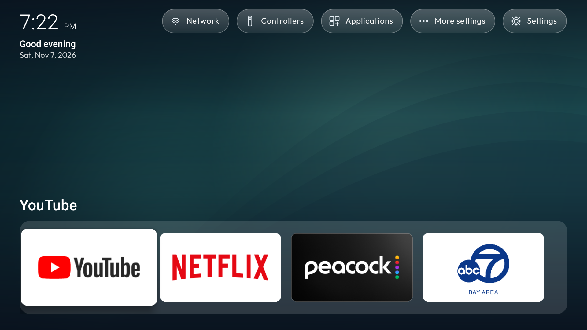

# Homestead Outfit

This fork uses Homestead 2.1.0’s upstream dock, app menus, focus effects and settings controls. Customization is isolated in Outfit classes and the build overlay to keep upstream merges small. See [upstream documentation](README.md) for the base launcher.

## Custom features

- Clock, time-of-day greeting and full date remain visible together above the dock.
- The personal TV profile applies YouTube, Netflix, Peacock and ABC7 in that order, with medium dock tiles. Later manual changes are preserved.
- Daily offline collections include 16 nature/abstract illustrations and all eight upstream landscapes. Choose Nature, Abstract or Mixed, or keep any artwork fixed.
- Settings → Background offers Bing image of the day and NASA APOD. Each source caches its last good photo; failures and NASA video days keep that cache, or use offline artwork before the first download.
- Online wallpaper status shows the source, image title, attribution, date and errors, with a manual refresh button. Downloads use HTTPS, bounded image sizes and atomic cache replacement. Existing personal photos are kept separately.
- Daily refresh runs while the launcher is open and on reopening. It does not wake the TV. Failed requests retry after an hour; successful requests wait until the next local calendar day.

NASA uses the shared DEMO_KEY and is subject to its rate limits. During verification on November 7, 2026, NASA returned a logo placeholder; Outfit rejects that response and retains a usable background.

## Build and checks

Use `build-local.sh` with the existing local Android toolchain and signing key. The build overlay packages upstream landscape assets and gives the app its separate Outfit identity. Run `JAVA_HOME=/path/to/jdk outfit/test.sh` for daily rotation, preference migration, download policy and upstream-boundary checks.

TV verification: version 2.1.0-outfit.7 installed successfully; screenshot confirms clock, greeting, full date and exact four-app order. Bing’s daily image downloaded successfully on the TV and was selected as the active source. Automated checks cover rotation across dates and source validation; a real overnight rollover has not been observed in this session.
